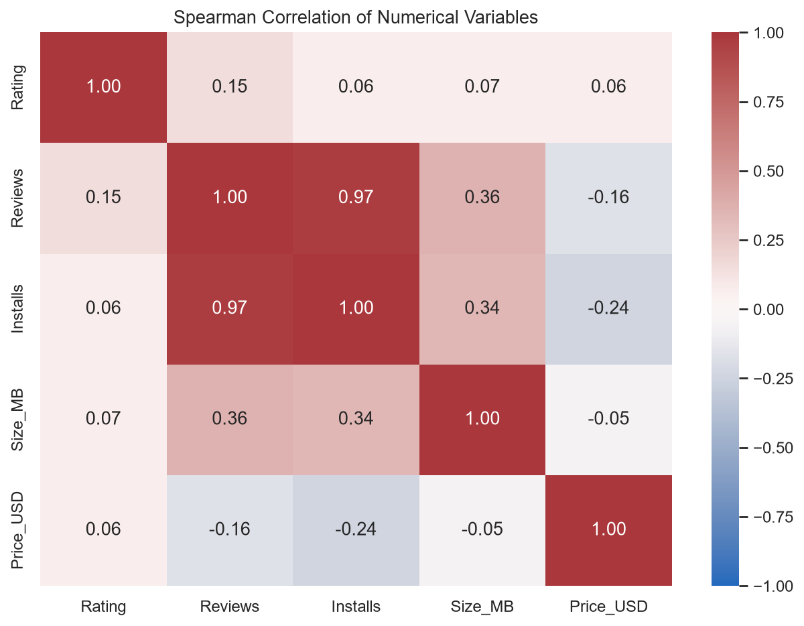
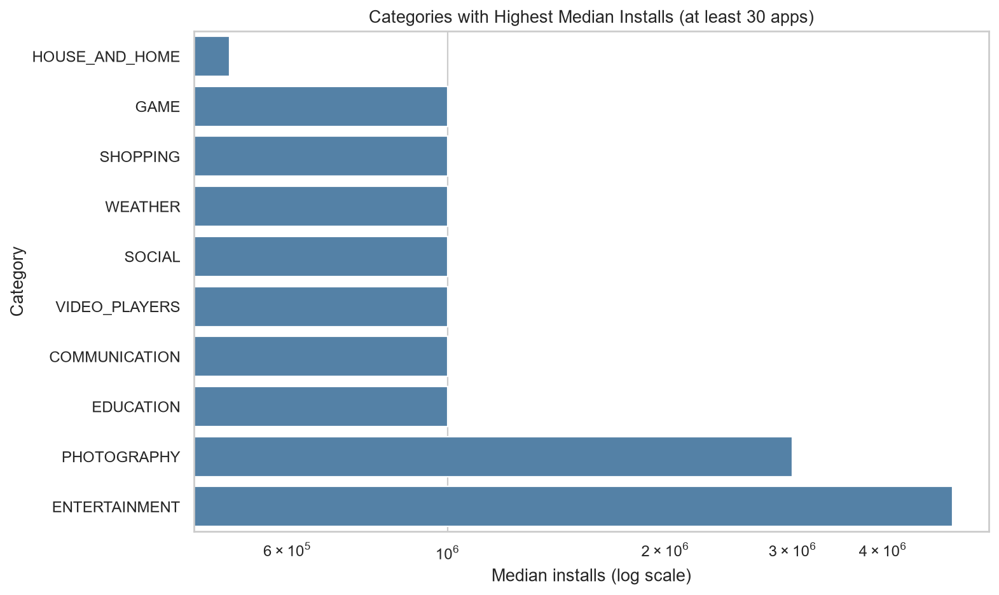
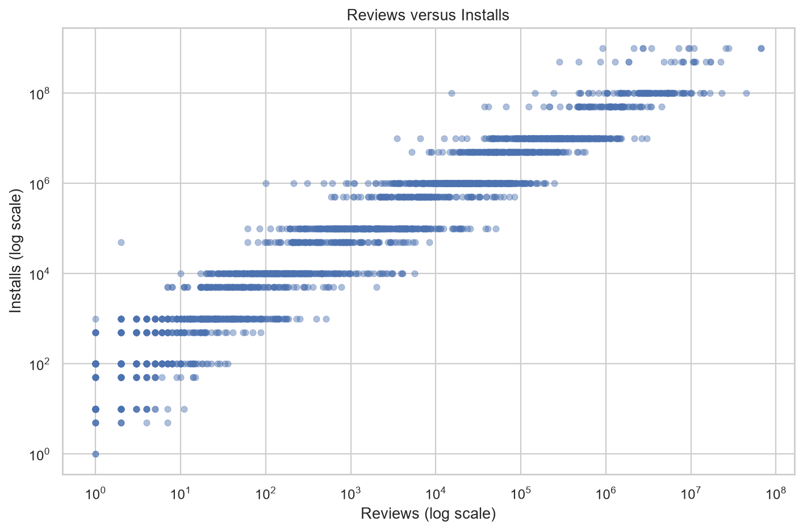
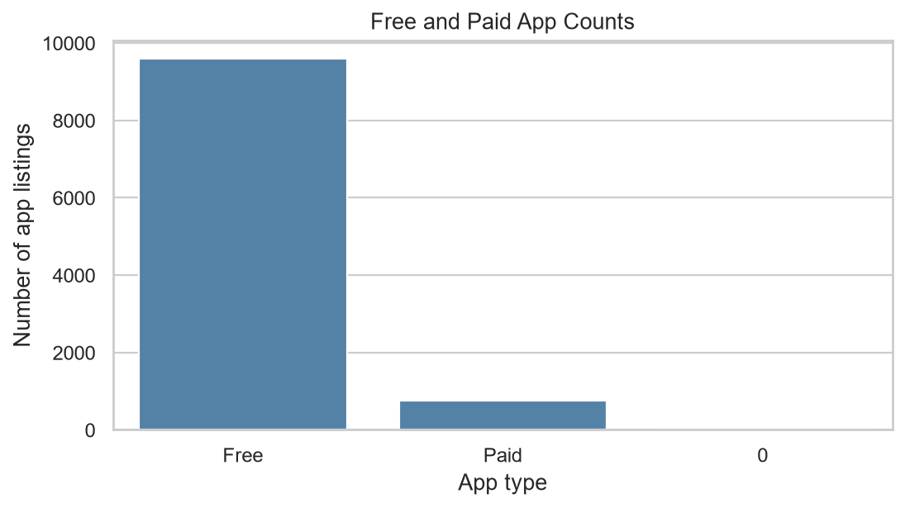

# Google Play Store Exploratory Data Analysis (EDA)

[](https://www.python.org/)
[](https://pandas.pydata.org/)
[](https://seaborn.pydata.org/)
[](#)

A modular, end-to-end data analysis and preprocessing pipeline exploring over 10,000 apps from the Google Play Store. This project investigates the relationships between app categories, ratings, user engagement, file sizes, and monetization models.

---

## 📌 Executive Summary & Key Findings

* **Market Monetization**: ~92.6% of apps on the Google Play Store are Free. Paid apps have a median price of $2.99, while the maximum observed price reaches $400.00.
* **Rating Distribution**: User ratings skew positively, with an overall median rating of **4.3 / 5.0** (IQR: 4.0 – 4.5). Books & Reference, Health & Fitness, and Events hold the highest category median ratings (4.5).
* **Engagement Dynamics**: App installs and review counts exhibit a near-perfect monotonic correlation (**Spearman $\rho = 0.971$**), while ratings correlate weakly with install thresholds ($\rho = 0.063$).
* **Category Scale**: Entertainment (5M median install threshold), Photography (3M), and Games/Communication/Video Players (1M) lead in user adoption thresholds.
* **App Footprint**: Median app size is **13.0 MB** (IQR: 4.7 MB – 29.0 MB), with sizes capping at 100 MB in this dataset.

---

## 📊 Visual Highlights

| Spearman Correlation Heatmap | Median Installs by Category |
| :---: | :---: |
|  |  |

| Reviews vs. Installs Relationship | Free vs. Paid App Distribution |
| :---: | :---: |
|  |  |

---

## 🛠 Project Workflow

The analysis is structured sequentially across four dedicated notebooks:

| Stage | Notebook | Description |
| :--- | :--- | :--- |
| **01** | [`01_data_understanding.ipynb`](notebooks/01_data_understanding.ipynb) | Dataset profiling, dimension auditing (10,841 rows, 13 features), data dictionary creation, and structural anomaly identification. |
| **02** | [`02_data_cleaning.ipynb`](notebooks/02_data_cleaning.ipynb) | De-duplication (retaining 10,358 unique rows), shifted-row correction, rating range validation (1.0–5.0), and disciplined missing-value isolation. |
| **03** | [`03_data_preprocessing.ipynb`](notebooks/03_data_preprocessing.ipynb) | Type transformations: cleans `Installs` & `Reviews` to integers, parses `Price` into `Price_USD`, extracts `Size_MB` from mixed units ('k'/'M'), and standardizes dates. |
| **04** | [`04_EDA.ipynb`](notebooks/04_EDA.ipynb) | Univariate and bivariate statistical analyses, log-transformed distribution modeling, category benchmarking, and export of visual reports. |

---

## 📁 Repository Structure

```text
Google_AppStore_EDA/
├── data/
│   ├── raw/                  # Original raw Google Play Store CSV (10,841 rows)
│   └── processed/            # Cleaned and preprocessed datasets ready for analysis
├── notebooks/
│   ├── 01_data_understanding.ipynb
│   ├── 02_data_cleaning.ipynb
│   ├── 03_data_preprocessing.ipynb
│   └── 04_EDA.ipynb
├── reports/
│   └── figures/              # Exported high-resolution publication charts
├── requirements.txt          # Python dependencies
└── README.md
```

---

## 🚀 Getting Started

### 1. Clone the Repository
```bash
git clone https://github.com/Pratham-Mishra225/Google_AppStore_EDA.git
cd Google_AppStore_EDA
```

### 2. Set Up Virtual Environment
```bash
python -m venv .venv
# Windows:
.venv\Scripts\activate
# macOS/Linux:
source .venv/bin/activate
```

### 3. Install Dependencies
```bash
pip install -r requirements.txt
```

### 4. Launch Jupyter Notebooks
```bash
jupyter notebook notebooks/
```
